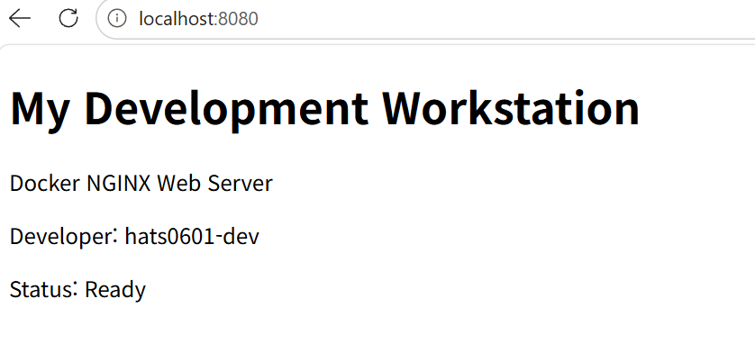
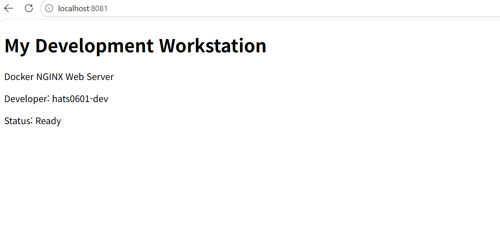
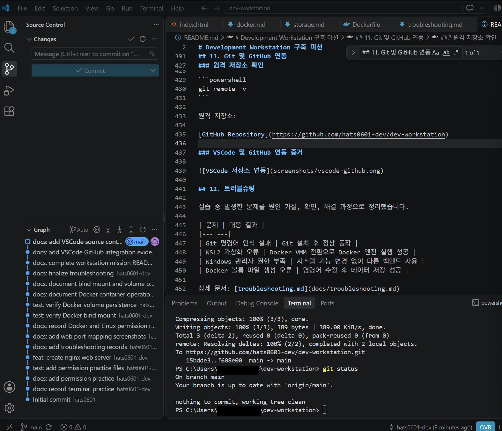

# Development Workstation 구축 미션

Windows 환경에서 터미널, Git/GitHub, Docker를 활용하여 개발 워크스테이션을 구축한 프로젝트입니다.

NGINX 웹 서버를 Docker 이미지로 제작하고 컨테이너 실행, 포트 매핑, 바인드 마운트, Docker 볼륨 영속성을 검증했습니다.

## 1. 프로젝트 목표

- 터미널 기반 파일 및 디렉터리 조작
- Windows ACL 및 Linux 파일 권한 이해
- Docker 설치와 컨테이너 실행 환경 구축
- Dockerfile을 이용한 커스텀 웹 서버 이미지 제작
- 포트 매핑을 통한 웹 서버 접속
- 바인드 마운트를 통한 파일 변경 반영
- Docker 볼륨을 통한 데이터 영속성 검증
- Git/GitHub 및 VSCode 연동
- 실행 결과와 트러블슈팅 문서화

## 2. 실행 환경

| 항목 | 환경 |
|---|---|
| OS | Windows |
| Shell | PowerShell |
| Editor | Visual Studio Code |
| Git | 2.56.0.windows.4 |
| Docker Desktop | 4.97.0 |
| Docker Engine / CLI | 29.9.2 |
| Docker Compose | 5.6.1 |
| Docker Context | desktop-linux |
| 컨테이너 OS | Linux |
| 웹 서버 | NGINX |
| 베이스 이미지 | nginx:stable-alpine |
| Ubuntu 이미지 | ubuntu:24.04 |
| Docker 실행 방식 | Docker VMM |

교육장 Windows PC에서 WSL2 가상화 문제가 발생하여 Docker VMM 백엔드로 변경한 뒤 Docker 실행에 성공했습니다.

Docker 환경 점검: [docker-check.txt](logs/docker-check.txt)

## 3. 프로젝트 구조

```text
dev-workstation/
├── README.md
├── Dockerfile
├── site/
│   └── index.html
├── practice/
│   └── hello.txt
├── permissions/
│   └── test.txt
├── docs/
│   ├── terminal.md
│   ├── permissions.md
│   ├── docker.md
│   ├── storage.md
│   └── troubleshooting.md
├── logs/
│   ├── docker-build.txt
│   ├── docker-check.txt
│   ├── hello-world.txt
│   ├── linux-permissions.txt
│   ├── web-8080.txt
│   ├── web-8081.txt
│   ├── bind-before.txt
│   ├── bind-after.txt
│   ├── volume-before.txt
│   └── volume-after.txt
└── screenshots/
    ├── web-8080.png
    ├── web-8081.png
    └── vscode-github.png
```

### 디렉터리 구조 설계 기준

프로젝트 파일을 역할에 따라 분리하여 개발, 실행, 검증 및 문서 관리를 쉽게 할 수 있도록 구성했습니다.

- `site/`: 웹 서버에 배포할 HTML 콘텐츠를 저장합니다.
- `docs/`: 실습 과정, 실행 방법, 트러블슈팅을 기록합니다.
- `logs/`: Docker와 터미널의 실제 실행 결과를 보관합니다.
- `screenshots/`: 브라우저 접속 및 Git 연동 증거를 저장합니다.
- `practice/`: 터미널 기본 조작 실습 파일을 관리합니다.
- `permissions/`: 파일 권한 실습 파일을 관리합니다.
- `Dockerfile`: 웹 서버 이미지를 재현하는 빌드 설정을 관리합니다.

이 구조를 선택한 이유는 **배포 대상 파일, 개발·실습 파일, 실행 증거를 서로 분리하기 위해서**입니다.

따라서 웹페이지를 수정할 때는 `site/`, 실행 결과를 확인할 때는 `logs/`, 작업 방법을 확인할 때는 `docs/`를 살펴보면 됩니다. 또한 다른 컴퓨터에서도 동일한 프로젝트 구조로 Docker 이미지를 빌드할 수 있습니다.


## 4. 미션 수행 체크리스트

- [x] Git 설치 및 GitHub 저장소 연동
- [x] VSCode 소스 제어 연동
- [x] 터미널 파일·디렉터리 조작
- [x] Windows ACL 권한 변경
- [x] Linux chmod 권한 변경
- [x] Docker 설치 및 엔진 점검
- [x] hello-world 및 Ubuntu 컨테이너 실행
- [x] Docker 이미지·컨테이너 운영 명령어 실습
- [x] Dockerfile 작성 및 커스텀 이미지 빌드
- [x] 웹 서버 8080·8081 포트 접속
- [x] 바인드 마운트 변경 반영 검증
- [x] Docker 볼륨 영속성 검증
- [x] GitHub Commit / Push / Pull
- [x] 트러블슈팅 2건 이상 문서화

## 5. 터미널 및 파일 권한 실습

### 터미널 명령어

PowerShell에서 파일과 디렉터리의 생성, 조회, 복사, 이름 변경, 삭제 등을 실습했습니다.

```powershell
pwd
Get-ChildItem -Force
mkdir practice
cd practice
New-Item -ItemType File -Name hello.txt
Set-Content hello.txt "Hello Dev Workstation"
Get-Content hello.txt
Copy-Item hello.txt copy.txt
Rename-Item copy.txt renamed.txt
Remove-Item renamed.txt
cd ..
```

상세 기록: [terminal.md](docs/terminal.md)

실제 실행 출력: [terminal-output.txt](logs/terminal-output.txt)

### Linux 파일 권한

Ubuntu 컨테이너에서 `chmod`로 파일과 디렉터리 권한을 변경했습니다.

```bash
chmod 600 /permission-test/test.txt
chmod 700 /permission-test
chmod 644 /permission-test/test.txt
chmod 755 /permission-test
```

| 대상 | 변경 과정 | 최종 권한 |
|---|---|---|
| 파일 | 644 → 600 → 644 | `rw-r--r--` |
| 디렉터리 | 755 → 700 → 755 | `rwxr-xr-x` |

권한의 숫자는 읽기(r=4), 쓰기(w=2), 실행(x=1)을 합산하여 표현합니다.

- [권한 실습 문서](docs/permissions.md)
- [Linux 권한 검증 로그](logs/linux-permissions.txt)

### 절대 경로와 상대 경로 선택 기준

**절대 경로**는 현재 작업 위치와 관계없이 파일의 전체 위치를 지정하는 방식입니다.

예시:

```powershell
C:\Users\사용자명\dev-workstation\site\index.html
```

**상대 경로**는 현재 작업 디렉터리를 기준으로 파일 위치를 지정하는 방식입니다.

예시:

```powershell
site\index.html
```

#### 언제 어떤 경로를 사용하는가?

- **절대 경로:** Docker 바인드 마운트처럼 호스트의 정확한 디렉터리 위치가 필요한 경우 사용합니다.
- **상대 경로:** 프로젝트 내부 파일을 참조하거나 다른 컴퓨터에서도 같은 프로젝트 구조를 사용할 때 적합합니다.
- **재현성:** 사용자마다 컴퓨터의 폴더 위치가 다르므로 사용자 이름이 포함된 절대 경로를 코드에 고정하지 않습니다.

이번 프로젝트의 Docker 바인드 마운트에서는 다음과 같이 현재 프로젝트 경로를 이용하여 절대 경로를 생성했습니다.

```powershell
docker run -d --name dev-web-bind -p 8082:80 --mount "type=bind,source=$((Get-Location).Path)\site,target=/usr/share/nginx/html,readonly" dev-workstation-web:1.0
```

`Get-Location`은 현재 위치를 확인하며, `.Path`는 해당 위치의 경로 문자열을 가져옵니다.

따라서 다른 컴퓨터에서도 프로젝트 루트에서 실행하면 해당 컴퓨터의 실제 경로를 사용하여 바인드 마운트할 수 있습니다.

### 절대 경로와 상대 경로 선택 기준

**절대 경로**는 현재 작업 위치와 관계없이 파일의 전체 위치를 지정하는 방식입니다.

예시:

```powershell
C:\Users\사용자명\dev-workstation\site\index.html
```

**상대 경로**는 현재 작업 디렉터리를 기준으로 파일 위치를 지정하는 방식입니다.

예시:

```powershell
site\index.html
```

#### 언제 어떤 경로를 사용하는가?

- **절대 경로:** Docker 바인드 마운트처럼 호스트의 정확한 디렉터리 위치가 필요한 경우 사용합니다.
- **상대 경로:** 프로젝트 내부 파일을 참조하거나 다른 컴퓨터에서도 같은 프로젝트 구조를 사용할 때 적합합니다.
- **재현성:** 사용자마다 컴퓨터의 폴더 위치가 다르므로 사용자 이름이 포함된 절대 경로를 코드에 고정하지 않습니다.

이번 프로젝트의 Docker 바인드 마운트에서는 다음과 같이 현재 프로젝트 경로를 이용하여 절대 경로를 생성했습니다.

```powershell
docker run -d --name dev-web-bind -p 8082:80 --mount "type=bind,source=$((Get-Location).Path)\site,target=/usr/share/nginx/html,readonly" dev-workstation-web:1.0
```

`Get-Location`은 현재 위치를 확인하며, `.Path`는 해당 위치의 경로 문자열을 가져옵니다.

따라서 다른 컴퓨터에서도 프로젝트 루트에서 실행하면 해당 컴퓨터의 실제 경로를 사용하여 바인드 마운트할 수 있습니다.

## 6. Docker 설치 및 기본 검증

### Docker 버전 및 엔진

```powershell
docker --version
docker info
```

확인한 결과:

```text
Docker version 29.9.2, build a82e528
Server Version: 29.9.2
Operating System: Docker Desktop
OSType: linux
Architecture: x86_64
```

### hello-world 실행

```powershell
docker run hello-world
```

실제 출력:

```text
Hello from Docker!
This message shows that your installation appears to be working correctly.
```

검증 로그: [hello-world.txt](logs/hello-world.txt)

### Ubuntu 컨테이너 실행

```powershell
docker run -it --name ubuntu-practice ubuntu:24.04 bash
```

Ubuntu 내부에서 `pwd`, `ls -la`, `echo`와 권한 변경을 실습하고, 컨테이너 종료 및 재진입을 확인했습니다.

### Docker 운영 명령어

```powershell
docker images
docker ps
docker ps -a
docker logs dev-web-8080
docker stats --no-stream
docker stop ubuntu-practice
```

- [Docker 운영 기록](docs/docker.md)
- [Docker 상태 로그](logs/docker-check.txt)

## 7. 커스텀 Docker 이미지 제작

### Dockerfile

베이스 이미지는 `nginx:stable-alpine`입니다. 직접 만든 HTML을 복사하고 이미지 메타데이터를 추가했습니다.

```dockerfile
FROM nginx:stable-alpine
LABEL org.opencontainers.image.title="dev-workstation-web"
LABEL org.opencontainers.image.description="Development workstation mission web server"
COPY site/ /usr/share/nginx/html/
EXPOSE 80
```

- [Dockerfile 원본](Dockerfile)
- [웹페이지 원본](site/index.html)

### 이미지 빌드

프로젝트 루트 디렉터리에서 실행합니다.

```powershell
docker build -t dev-workstation-web:1.0 .
```

실제 빌드 출력 로그: [docker-build.txt](logs/docker-build.txt)

이미지 확인:

```powershell
docker images
```

생성된 이미지: `dev-workstation-web:1.0`

## 8. 포트 매핑 및 웹 서버 검증

### 8080 포트

```powershell
docker run -d --name dev-web-8080 -p 8080:80 dev-workstation-web:1.0
curl.exe -i http://localhost:8080
```

실제 응답 상태:

```text
HTTP/1.1 200 OK
Server: nginx/1.30.6
```



응답 기록: [web-8080.txt](logs/web-8080.txt)

### 8081 포트

```powershell
docker run -d --name dev-web-8081 -p 8081:80 dev-workstation-web:1.0
curl.exe -i http://localhost:8081
```



응답 기록: [web-8081.txt](logs/web-8081.txt)

`-p 8080:80`은 호스트의 8080번 포트를 컨테이너 내부 80번 포트에 연결합니다. 동일한 이미지로 다른 포트의 컨테이너를 실행할 수 있습니다.

### 포트 충돌 진단 및 해결 방법

포트 충돌은 이미 다른 프로그램이나 컨테이너가 사용 중인 호스트 포트를 새 컨테이너에서도 사용하려 할 때 발생합니다.

예를 들어 8080번 포트가 사용 중이라면 다른 컨테이너가 같은 주소와 포트를 사용할 수 없습니다.

#### 1. 포트 사용 여부 확인

PowerShell에서 8080번 포트를 사용 중인 프로세스를 확인합니다.

```powershell
Get-NetTCPConnection -LocalPort 8080 -State Listen -ErrorAction SilentlyContinue
```

`OwningProcess` 값은 포트를 사용하는 프로세스의 PID입니다.

프로세스 이름 확인:

```powershell
Get-Process -Id <PID>
```

위 명령어의 `<PID>`는 실제 확인한 숫자로 바꿔 입력합니다.

대체 명령어:

```powershell
netstat -ano | findstr :8080
```

Linux에서는 다음 명령어를 사용할 수 있습니다.

```bash
ss -ltnp
```

#### 2. Docker 컨테이너 확인

```powershell
docker ps
```

`PORTS` 항목에서 `0.0.0.0:8080->80/tcp` 등의 매핑을 확인합니다.

#### 3. 포트 충돌 해결

8080번 포트를 사용하는 컨테이너가 있고 중지해도 되는 경우:

```powershell
docker stop dev-web-8080
```

기존 서비스를 중지하면 안 되는 경우에는 다른 호스트 포트를 사용합니다.

```powershell
docker run -d --name dev-web-8083 -p 8083:80 dev-workstation-web:1.0
```

이후 새 포트로 접속합니다.

```powershell
curl.exe -i http://localhost:8083
```

#### 4. 해결 여부 검증

```powershell
docker ps
```

새 포트 매핑을 확인하고 `curl.exe` 결과가 `HTTP/1.1 200 OK`인지 검증합니다.

**주의:** 이 내용은 포트 충돌 발생 시 사용할 진단 및 해결 절차입니다. 이번 실습에서 실제로 포트 충돌이 발생했다는 의미는 아닙니다.

## 9. 바인드 마운트 검증

호스트의 `site` 폴더를 컨테이너 내부 NGINX 웹 루트에 읽기 전용으로 연결했습니다.

```powershell
docker run -d --name dev-web-bind -p 8082:80 --mount "type=bind,source=$((Get-Location).Path)\site,target=/usr/share/nginx/html,readonly" dev-workstation-web:1.0
```

변경 전:

```html
<p>Status: Ready</p>
```

변경 후:

```html
<p>Status: Bind Mount Updated!</p>
```

호스트 파일을 변경한 후 컨테이너를 재시작하거나 이미지를 다시 빌드하지 않고 확인했습니다.

```powershell
curl.exe http://localhost:8082
```

- [변경 전 응답](logs/bind-before.txt)
- [변경 후 응답](logs/bind-after.txt)
- [스토리지 실습 문서](docs/storage.md)

## 10. Docker 볼륨 영속성 검증

```powershell
docker volume create workstation-data
docker run -d --name volume-test-1 -v workstation-data:/data ubuntu:24.04 sleep infinity
docker exec volume-test-1 sh -c 'echo Docker_Volume_Persistence_Test > /data/test.txt'
docker exec volume-test-1 cat /data/test.txt
```

첫 번째 컨테이너에서 확인한 값:

```text
Docker_Volume_Persistence_Test
```

첫 번째 컨테이너를 삭제하고 같은 볼륨을 연결한 두 번째 컨테이너를 실행했습니다.

```powershell
docker rm -f volume-test-1
docker run -d --name volume-test-2 -v workstation-data:/data ubuntu:24.04 sleep infinity
docker exec volume-test-2 cat /data/test.txt
```

두 번째 컨테이너에서도 같은 데이터를 확인했습니다.

```text
Docker_Volume_Persistence_Test
```

- [삭제 전 데이터](logs/volume-before.txt)
- [삭제 후 데이터](logs/volume-after.txt)
- [볼륨 영속성 실습 문서](docs/storage.md)

## 11. Git 및 GitHub 연동

Git 설정 및 GitHub 연결 확인 로그: [git-check.txt](logs/git-check.txt)

### Git 설정

```powershell
git config --global user.name "hats0601-dev"
git config --global init.defaultBranch main
git config --global --list
```

Git 이메일도 설정했습니다. 문서에는 개인 이메일 주소를 기록하지 않았습니다.

### 저장소 복구 및 업데이트

```powershell
git clone https://github.com/hats0601-dev/dev-workstation.git
cd dev-workstation
git pull origin main
```

### 변경 사항 업로드

```powershell
git add .
git commit -m "docs: update workstation mission"
git push origin main
git status
```

원격 저장소: [dev-workstation GitHub](https://github.com/hats0601-dev/dev-workstation)

### VSCode 및 GitHub 연동 증거



VSCode Source Control에서 `main` 브랜치 및 Commit 기록을 확인했습니다.

## 12. 트러블슈팅

| 문제 | 대응 결과 |
|---|---|
| Git 명령어 인식 실패 | Git 설치 후 정상 동작 |
| WSL2 가상화 오류 | Docker VMM 전환으로 Docker 엔진 실행 성공 |
| Windows 관리자 권한 부족 | 시스템 기능 변경 없이 다른 백엔드 사용 |
| Docker 볼륨 파일 생성 오류 | 명령어 수정 후 데이터 저장 성공 |

상세 기록: [troubleshooting.md](docs/troubleshooting.md)

## 13. 재현 방법

### 준비 사항

- Docker 엔진을 실행할 수 있는 Windows 환경
- Docker Desktop
- Git
- 인터넷 연결

### 저장소 가져오기

```powershell
git clone https://github.com/hats0601-dev/dev-workstation.git
cd dev-workstation
```

### Docker 실행 및 이미지 빌드

```powershell
docker info
docker build -t dev-workstation-web:1.0 .
```

### 웹 서버 실행

```powershell
docker run -d --name dev-web-8080 -p 8080:80 dev-workstation-web:1.0
curl.exe -i http://localhost:8080
```

브라우저 접속 주소: http://localhost:8080

### 주의사항

- 컨테이너 이름이나 호스트 포트가 이미 사용 중이면 이름 또는 포트를 변경해야 합니다.
- 바인드 마운트는 현재 프로젝트 경로를 기준으로 실행해야 합니다.
- Docker 실행 백엔드는 PC의 가상화 지원과 설정에 따라 달라질 수 있습니다.
- GitHub에는 소스코드와 증거 파일이 저장되지만 Docker 이미지, 컨테이너, 볼륨 데이터 자체는 자동으로 동기화되지 않습니다.
- Docker 환경이 초기화되면 이미지 빌드와 컨테이너 실행을 다시 수행해야 합니다.

## 14. 최종 결과

Windows 환경에서 Git/GitHub와 Docker를 연동하고 NGINX 웹 서버를 컨테이너화했습니다.

Docker 이미지와 컨테이너, 포트 매핑, 바인드 마운트, 볼륨 영속성을 실제 명령어와 출력으로 검증했습니다. 제한된 교육장 환경에서 발생한 문제는 Docker VMM 백엔드를 사용하여 해결했습니다.

실습 상세 내용은 `docs/`, 실제 결과 로그는 `logs/`, 화면 증거는 `screenshots/`에서 확인할 수 있습니다.
